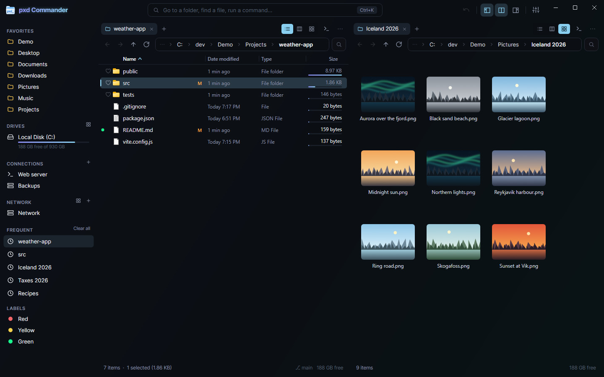
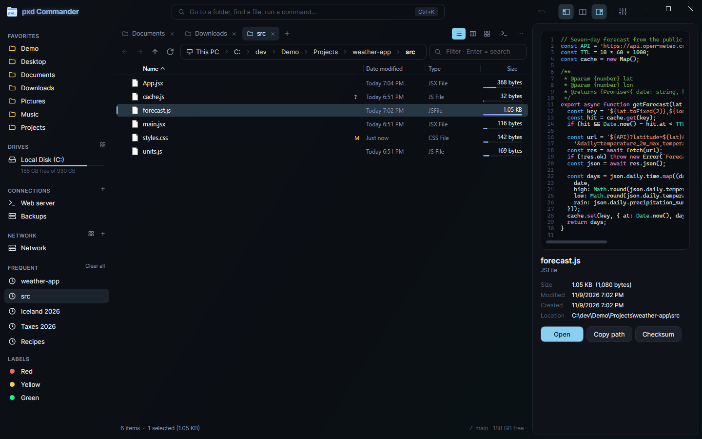
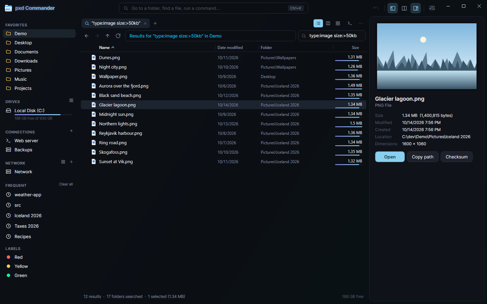
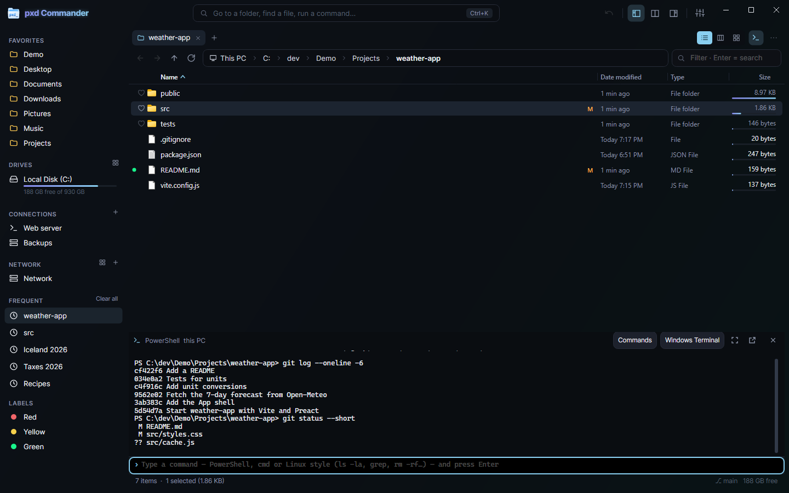
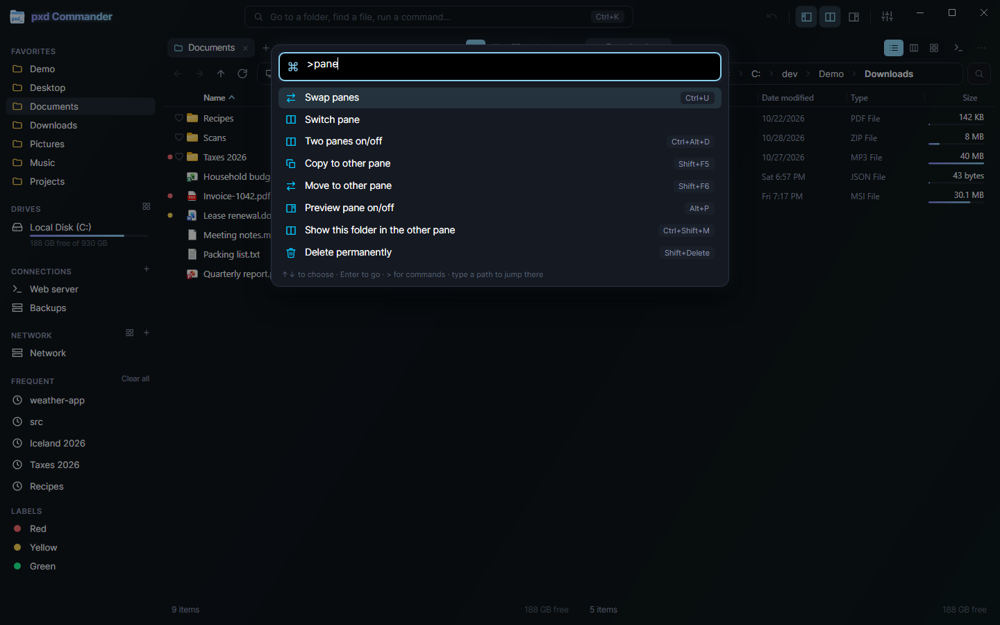
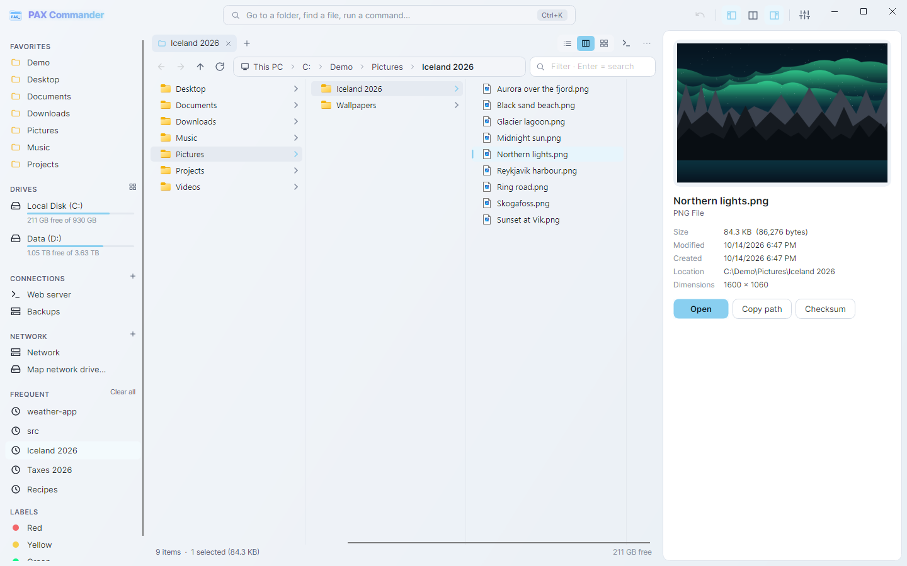

# pxd Commander

A fast two-pane file manager for Windows, built to replace File Explorer: tabs, a real search, FTP/SFTP servers and a built-in terminal, all in one window.



**[Download the latest version](https://github.com/pxdtek/pxdCommander/releases/latest)** for Windows 10/11 (64-bit). No admin rights or .NET install needed.

## Features

### Browsing
- **Two panes, each with tabs.** Side by side or stacked. Your tabs and folders come back when you restart.
- **Three views:** details list, thumbnails, and Miller columns.
- **Built-in image viewer** with deep, high-quality zoom and folder slideshows that can keep your zoom level ([pxd Image Viewer](https://github.com/pxdtek/pxdImageViewer), also available on its own).
- **Preview pane and Quick Look** (Space) for pictures, video, audio, PDF and Office files, archives, text and code. Code is colored by language, with line numbers; minified JSON and XML are laid out.
- **Address bar** with breadcrumbs you can click or type into, with folder autocomplete.
- **Sidebar** with favorites, drives (as a list or compact tiles), saved connections, network, frequent folders and color labels.
- **Git status** on files and folders, **folder sizes** with size bars, and natural sort (`file2` before `file10`).
- **Go anywhere** (Ctrl+K): jump to a folder, file or command by typing a few letters.
- **Command palette** (Ctrl+Shift+P) with every command and its shortcut.

### File operations
- **Background job queue** for copy, move, delete and zip, with conflict handling, pause, and **undo / redo**.
- **Batch rename.**
- **Recycle Bin**, with restore.
- **Works with Explorer:** real shell icons and thumbnails, the native right-click menu, and copy and paste between the two.

### Search
Searches run in parallel through all subfolders. Type in the filter box (Ctrl+F) and press Enter.

```text
report ext:pdf size:>2mb modified:thisweek
type:image size:1mb..5mb -ext:gif
content:"TODO" modified:<30d
```

| Filter | Examples |
| --- | --- |
| `ext:` | `ext:pdf`, `ext:jpg,png` |
| `type:` | `image`, `video`, `audio`, `doc`, `archive`, `code`, `folder`, `file` |
| `size:` | `>10mb`, `<1kb`, `1mb..5mb`, `empty` |
| `modified:` / `created:` | `today`, `yesterday`, `thisweek`, `lastmonth`, `7d`, `<30d`, `>1y`, `2026-01-01..2026-02-01` |
| `content:` | `content:"some text"` (inside text-like files) |
| `re:` | a regular expression on the name |
| `hidden:` | `yes`, `no`, `only` |

Plain words must all appear in the name, in any order. `"quoted text"` is one term, `*` and `?` match whole names, and a `-` in front of any word or filter excludes it.

### Remote servers and terminal
- **FTP, FTPS and SFTP** connections browse like local folders. Copy between this PC and a server, or between two servers. Host keys are trusted on first use, then checked.
- **Docked terminal** in every tab (Ctrl+\`): PowerShell on this PC, or SSH on a server. The file view and the terminal follow each other's folder. Common Windows commands (`dir`, `cls`, `copy`) work on Linux servers, and Linux-style commands (`ls -la`, `grep`) work in PowerShell.
- **Command suggestions** while you type: your saved snippets, commands you've run before, and a library of common admin commands. Lines that look like they contain a password are never remembered.
- **Microsoft 365 admin connections** (Exchange Online, Graph, Teams, SharePoint, Security & Compliance, Azure) that sign in through the docked PowerShell.
- **Network:** browse computers and shared folders, and map or disconnect network drives.
- **Disk images:** shows which ISO or VHD a drive letter is mounted from; mount and unmount.

### Look
- Dark and light themes, or follow Windows. The accent color is yours to pick.
- Its own title bar, in the same style as the rest of the window.
- One window at a time: opening pxd Commander again hands the folder to the window that's already open.

## Screenshots

| | |
| --- | --- |
|  |  |
| **Preview pane** with colored code, and several tabs | **Search** with filters, results from every subfolder |
|  |  |
| **Docked terminal** that follows the folder you're in | **Command palette** (Ctrl+Shift+P) |
|  | |
| **Light theme**, columns view and image preview | |

## Supported systems

| System | Status |
| --- | --- |
| Windows 11, 64-bit (x64) | **Supported.** Tested; this is where it's used every day. |
| Windows 10, 64-bit (x64) | **Supported**, but not tested as often. Needs a Windows 10 version that .NET 10 supports. |
| Windows on ARM | No native build. The x64 version should run under Windows' x64 emulation, but this hasn't been tested. |
| Windows, 32-bit | Not supported. |
| Linux | **Not supported.** The code builds for `linux-x64` and has fallbacks for the Windows-only parts, but it has never been run there and there is no download. |
| macOS | **Not supported.** Same as Linux: not tested, no download. |

The Windows-only parts are: shell icons and thumbnails, the native right-click menu, Explorer clipboard interop, the Recycle Bin, network browsing and drive mapping, ISO/VHD mounting, saved passwords (Windows Credential Manager), the local PowerShell terminal, Microsoft 365 connections, the Properties dialog and the installer.

## Install

Downloads are on the [latest release](https://github.com/pxdtek/pxdCommander/releases/latest) page:

| File | What it is |
| --- | --- |
| `pxdCommander-1.2.0-win-x64-setup.exe` | Installer (recommended) |
| `pxdCommander-1.2.0-win-x64-portable.zip` | Portable version: one exe, nothing installed |
| `pxdcomm-setup.exe` | The same installer, under a name that stays the same between versions |
| `*.sha256` | SHA-256 checksum for each file |

Both are self-contained: .NET does not need to be installed.

### Windows: installer

1. Download `pxdCommander-1.2.0-win-x64-setup.exe` and run it.
2. Choose the folder (default `%LOCALAPPDATA%\Programs\pxd Commander`), whether you want a desktop shortcut, and whether folders should get **Open in pxd Commander** on their right-click menu.
3. Click **Install**. No admin rights are needed: everything is installed for your user account only.

It adds a Start menu shortcut and an entry in **Settings ▸ Apps ▸ Installed apps**. To update, run the newer setup; it closes pxd Commander if it's open and replaces it in place. You rarely need to: when a newer release is out, pxd Commander installs it by itself before it opens (it asks pxdtek.com, or GitHub when pxdtek.com is blocked; set `PXD_NO_UPDATE=1`, or turn off "Check for updates", to stop that).

The files aren't code-signed, so Windows SmartScreen may say "Windows protected your PC". Click **More info**, then **Run anyway**. You can check the download first:

```powershell
Get-FileHash .\pxdCommander-1.2.0-win-x64-setup.exe -Algorithm SHA256
# compare with the hash in pxdCommander-1.2.0-win-x64-setup.exe.sha256
```

**Silent install** (for scripts and deployment):

```powershell
.\pxdCommander-1.2.0-win-x64-setup.exe --quiet
.\pxdCommander-1.2.0-win-x64-setup.exe --quiet --dir "D:\Apps\pxd Commander" --no-desktop --no-folder-menu
```

| Option | Effect |
| --- | --- |
| `--quiet` | Install without any window |
| `--dir <folder>` | Install folder (default: where it's installed now, else `%LOCALAPPDATA%\Programs\pxd Commander`) |
| `--no-desktop` | No desktop shortcut |
| `--no-folder-menu` | No "Open in pxd Commander" on folder right-click menus |

### Windows: portable

1. Download `pxdCommander-1.2.0-win-x64-portable.zip` and unzip it anywhere (a USB stick works).
2. Run `pxdCommander.exe`.

Nothing is registered: no shortcuts, no right-click entry, no Apps entry. Settings still go to `%APPDATA%\pxdCommander` unless you set `PXDCMD_DATA` (see [Data and settings](#data-and-settings)). Don't rename the exe to anything containing "setup", or it starts the installer instead.

### Uninstall

- **Settings ▸ Apps ▸ Installed apps ▸ pxd Commander ▸ Uninstall.** You can choose to also remove your settings, saved connections and their passwords. Your own files are never touched.
- Silently (keeps your settings):

  ```powershell
  & "$env:LOCALAPPDATA\Programs\pxd Commander\pxdCommander.exe" --uninstall --quiet
  ```

- Portable version: delete its folder, and `%APPDATA%\pxdCommander` if you want the settings gone too.

### Linux and macOS

There are no downloads. If you want to experiment, [build from source](#build-from-source) with `-r linux-x64` or `-r osx-arm64`, and expect missing features and rough edges.

## Build from source

Needs the [.NET 10 SDK](https://dotnet.microsoft.com/download).

```powershell
git clone https://github.com/pxdtek/pxdImageViewer.git   # the image viewer, referenced from next door
git clone https://github.com/pxdtek/pxdCommander.git
cd pxdCommander
dotnet run -c Release
```

Publish a framework-dependent build (needs the .NET 10 Desktop Runtime on the target PC):

```powershell
dotnet publish -c Release -r win-x64 --self-contained false -p:DebugType=none -o publish
```

Build the self-contained installer (`pxdcomm-setup.exe` plus its `.sha256`):

```powershell
.\installer\build-setup.ps1                  # output: %LOCALAPPDATA%\pxdCommander\installer
.\installer\build-setup.ps1 -OutDir .\dist   # or a folder of your choice
```

The installer is the app itself, published as one self-contained file. When its file name contains "setup" (or it's started with `--install`), it shows the install screen instead of the file manager. The portable zip holds the same file, named `pxdCommander.exe`.

For a release, bump `<Version>` in `pxdCommander.csproj` and add an entry to [CHANGELOG.md](CHANGELOG.md).

`pxdCommander.exe --self-test <report.txt>` checks a build without opening a window: the settings migration and the installer, run against temp folders and a private registry hive.

The README screenshots come from `tools/Screenshots` (Avalonia.Headless, no window): `dotnet run --project tools\Screenshots -c Release -- docs\screenshots C:\dev\Demo`. The second argument is where it builds the made-up sample folders (they show in the pictures, so use a short path without your user name); it deletes them afterwards.

## Data and settings

Everything lives in `%APPDATA%\pxdCommander`. Set the environment variable `PXDCMD_DATA` to a folder to keep it somewhere else. Settings, saved passwords and an installation from versions before the rename to pxd move across automatically (1.4.0).

| File | Contents |
| --- | --- |
| `settings.json` | Settings, window size, open tabs, favorites |
| `history.json` | Frequent folders |
| `labels.json` | Color labels |
| `connections.json` | Saved FTP/SFTP servers (no passwords) |
| `m365.json` | Saved Microsoft 365 connections (no passwords) |
| `terminal-commands.json` | Saved snippets and remembered terminal commands |
| `errors.log` | Errors, for troubleshooting |

Passwords for servers and Microsoft 365 are kept in **Windows Credential Manager**, never in these files.

The installer writes only per-user registry keys, and uninstalling removes them: `HKCU\Software\Microsoft\Windows\CurrentVersion\Uninstall\pxdCommander` for the Apps entry, and `HKCU\Software\Classes\Directory\shell\pxdCommander`, `...\Directory\Background\shell\pxdCommander` and `...\Drive\shell\pxdCommander` for the right-click entry.

## Keyboard shortcuts

Press **F1** in the app for the full, searchable list.

| Finding and moving | |
| --- | --- |
| Go anywhere | Ctrl+K or Ctrl+P |
| Command palette | Ctrl+Shift+P |
| Edit the path | Ctrl+L, Alt+D or F4 |
| Filter this folder (Enter searches subfolders) | Ctrl+F or F3 |
| Back / Forward / Up | Alt+Left / Alt+Right / Alt+Up (or Backspace) |
| Refresh | F5 or Ctrl+R |
| Home folder | Alt+Home |

| Tabs, panes and views | |
| --- | --- |
| New tab / Close tab | Ctrl+T / Ctrl+W |
| Reopen closed tab | Ctrl+Shift+T |
| Next / previous tab | Ctrl+Tab / Ctrl+Shift+Tab |
| Go to tab 1–8 / last tab | Ctrl+1 … Ctrl+8 / Ctrl+9 |
| Switch pane | Tab |
| Two panes on/off | Ctrl+Alt+D |
| Swap panes | Ctrl+U |
| Show this folder in the other pane | Ctrl+Shift+M |
| Sidebar / Preview pane | Ctrl+B / Alt+P |
| Details / Columns / Thumbnails view | Ctrl+Shift+1 / 2 / 3 |
| Show hidden files | Ctrl+H |
| Calculate folder sizes | Ctrl+Shift+S |
| Light / dark theme | Ctrl+Alt+L |
| New window | Ctrl+N |
| Settings | Ctrl+, |

| Files | |
| --- | --- |
| Open / open in a new tab | Enter / Ctrl+Enter |
| Quick Look | Space |
| Copy / Cut / Paste | Ctrl+C / Ctrl+X / Ctrl+V |
| Copy path | Ctrl+Shift+C |
| Copy / move to the other pane | Shift+F5 / Shift+F6 |
| Rename | F2 |
| Delete to Recycle Bin / permanently | Delete / Shift+Delete |
| New folder / new text file | Ctrl+Shift+N / Ctrl+Alt+N |
| Undo / Redo | Ctrl+Z / Ctrl+Y or Ctrl+Shift+Z |
| Select all / invert selection | Ctrl+A / Ctrl+I |
| Select or unselect the focused item | Ctrl+Space |
| Context menu | Shift+F10 or the Menu key |
| Properties | Alt+Enter |
| Show in Explorer | Ctrl+Shift+E |

| Terminal | |
| --- | --- |
| Show / hide the terminal | Ctrl+\` |
| Full size / back | Ctrl+Shift+\` |
| Previous / next command | Up / Down |
| Take a suggestion (without running it) | Tab |

## Code layout

| Folder | What's there |
| --- | --- |
| `Core/` | Files and folders, settings, frecency, labels, undo, the shells, Git status, the installer |
| `Core/Remote/` | FTP/SFTP file systems, transfers, the SSH shell, Windows-command translation |
| `Ops/` | The copy, move, delete and zip engines and the job queue |
| `Search/` | Query parser, parallel tree walker, content scanner, natural sort |
| `Platform/Win32/` | Shell icons, thumbnails, context menu, clipboard, Recycle Bin, network, disk images, Credential Manager |
| `Views/` | Main window, panes, list / tile / columns views, preview, terminal, dialogs, themes |
| `installer/` | `build-setup.ps1`, which builds the installer |
| `Assets/` | App icon |
| `docs/screenshots/` | The pictures in this README |

The UI is built in C# code; `App.axaml` holds only styles and theme resources.

Built with [Avalonia](https://avaloniaui.net/) 12 on .NET 10, with [FluentFTP](https://github.com/robinrodricks/FluentFTP) and [SSH.NET](https://github.com/sshnet/SSH.NET).

Changes between versions are in [CHANGELOG.md](CHANGELOG.md).
